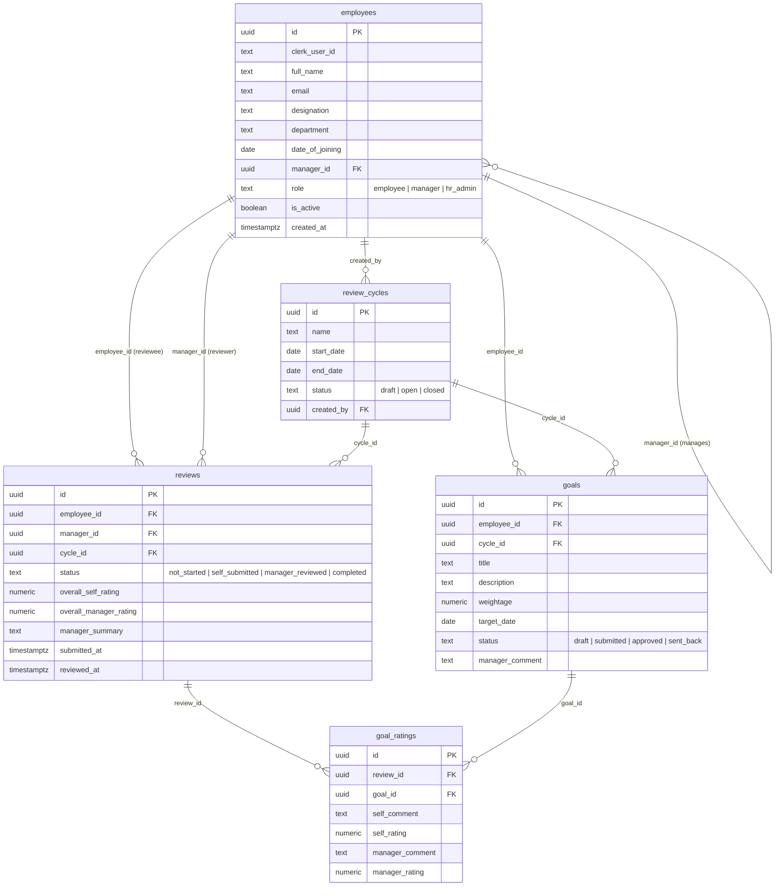

# Data Model

Five tables. Every primary key is a UUID. Every relationship is a real foreign key.

## What each foreign key means (one line each)

| Foreign key | Meaning |
|---|---|
| `employees.manager_id -> employees.id` | Who this person reports to. A manager is just an employee row that others point at; no separate managers table. |
| `review_cycles.created_by -> employees.id` | The HR admin who created the cycle. |
| `goals.employee_id -> employees.id` | Whose goal this is. |
| `goals.cycle_id -> review_cycles.id` | Which appraisal cycle the goal belongs to; goals never exist outside a cycle. |
| `reviews.employee_id -> employees.id` | The person being appraised. |
| `reviews.manager_id -> employees.id` | The reviewer, copied from the employee's manager when the review is created, so history survives if the hierarchy changes. |
| `reviews.cycle_id -> review_cycles.id` | The cycle this review belongs to. One review per employee per cycle. |
| `goal_ratings.review_id -> reviews.id` | The review these per-goal ratings belong to. |
| `goal_ratings.goal_id -> goals.id` | The goal being rated. Ratings live here, never on `goals`. |

## Design rules

- A manager's name is never stored as text, always `manager_id`.
- `reviews` has one row per employee per cycle and its `status` column **is** the workflow.
- Only one `review_cycles` row may be `open` at a time.
- Row Level Security is on for every table; all access happens on the server.
